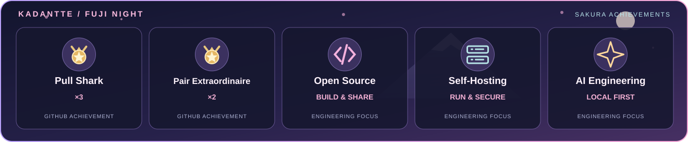

<!-- ══════════ ⛩️ KADANTTE / SAKURA NIGHT ⛩️ ══════════ -->
<!-- Public profile README • keep private infrastructure URLs, secrets and unreleased source code out of this file. -->

<div align="center">
  

  <a href="https://github.com/Kadantte">
    
  </a>

  <p>
    <a href="https://kadantte.moe"></a>
    <a href="https://github.com/Oppa-TECH"></a>
    <a href="mailto:jae-jin@kadantte.moe"></a>
  </p>

  <p><b>Full-Stack Engineering · DevOps &amp; Self-Hosting · Security · Local AI · Open Source</b></p>
  <p><i>Building useful things, securing the weird things, and somehow ending up with another server.</i> 🦊</p>
</div>

<p align="center">
  
</p>

<!-- ══════════ 🦊 ABOUT ══════════ -->


### 🦊 About me

```yaml
name:       Jae Jin
handle:     '@Kadantte'
location:   Republic of Korea 🇰🇷
pronouns:   He/Him
role:       Founder & Developer @ Oppa TECH
focus:      Full-stack · DevOps · Cybersecurity · AI/ML
interests:  Anime · Manga · Games · Graphic Design
mission:    Build it well. Secure it. Self-host it.
status:     🍑 Always yelling, never shuts up about anime
```

I'm **Jae Jin**, better known online as **Kadantte**. I love designing and building software from the interface all the way down to the infrastructure it runs on.

My work lives at the intersection of **web applications, DevOps, security engineering, automation, local LLMs, and GPU computing**. I enjoy running my own services, understanding systems deeply, and making tools that are both practical and pleasant to use.

A good part of my work happens in private or self-hosted repositories, so this profile mixes **public open-source projects** with a short overview of **ongoing builds**.

<br clear="right" />

<div align="center">
  
  
  
</div>

<p align="center">
  
</p>

<!-- ══════════ ⚔️ ENGINEERING ══════════ -->

<h3 align="center">⚔️ My Arsenal</h3>

<div align="center">
  <p><b>Languages &amp; application development</b></p>
  <br />
  
  <p><b>Infrastructure, data &amp; AI</b></p>
  
</div>

<br />

| 💻 Build | 🛡️ Secure | 🏠 Run | 🤖 Explore |
|:--|:--|:--|:--|
| Full-stack apps, APIs, desktop apps, UX | Authentication, audits, MFA, defense in depth | Proxmox, TrueNAS, Docker, Forgejo CI/CD | Ollama, CUDA, PyTorch, OCR, embeddings |
| TypeScript, Python, Rust, PHP, C# | Rate limiting, RLS, secret hygiene | Linux, monitoring, networking, backups | Self-hosted LLMs, retrieval, computer vision |

<details>
<summary><b>🖥️ Peek inside my homelab</b></summary>
<br />

- **Asura**, my development workstation: Ryzen 9 7900 + GeForce RTX 3080 Ti, Windows 11 and Linux tooling.
- **GPU lab:** Threadripper PRO platform with dual RTX 5090 GPUs for local model experimentation and inference.
- **Infrastructure:** Proxmox, virtual machines, TrueNAS storage, Docker workloads, Forgejo, CI runners, reverse proxies and observability.
- **AI & data:** Ollama, PyTorch/CUDA, PostgreSQL, Redis, Neo4j and Qdrant, with a strong preference for local-first systems.

*Details about access, internal networking, credentials, and security configurations stay private.* 🔐

</details>

<p align="center">
  
</p>

<!-- ══════════ 🔬 CURRENT BUILDS ══════════ -->

<h3 align="center">🔬 What I'm Building</h3>

<p align="center"><i>Selected ongoing work — some projects are private, experimental, or not yet released.</i></p>

| Project | What I'm working on |
|:--|:--|
| **🔑 Kagishiro** | A secure, self-hosted Ollama API gateway with API keys, quotas, streaming, observability and an admin dashboard. |
| **🌸 Shiori** | An anime-focused companion with title detection, human confirmation, tracking and playback-progress workflows. |
| **🧠 Advisio 2.0** | AI-powered application development spanning identity, email integrations, knowledge workflows and translation features. |
| **🛡️ Kleeja security** | Research and proposed hardening for PHP administration: adaptive login protection, cross-IP abuse detection, MFA and passkeys. |
| **📡 Telematics & tracking** | Integrations and protocol research around Teltonika devices, Traccar and custom data backends. |
| **🏗️ Home infrastructure** | Automating and securing self-hosted apps, GPU inference, deployment pipelines and system monitoring. |

<p align="center">I care about <b>secure defaults</b>, <b>real tests</b>, <b>maintainable architecture</b> and <b>shipping with intention</b>.</p>

<p align="center">
  
</p>

<!-- ══════════ 📌 PUBLIC PROJECTS ══════════ -->

<h3 align="center">📌 Public Projects &amp; Open Source</h3>

<div align="center">
  <a href="https://github.com/Kadantte/Kurumi"></a>
  <a href="https://github.com/Kadantte/Candy-website"></a>
  <br />
  <a href="https://github.com/Kadantte/mikazuki"></a>
  <a href="https://github.com/Kadantte/DeepLearningAnimePapers"></a>
  <br />
  <a href="https://github.com/Kadantte/Suwayomi-Server"></a>
</div>

<p align="center">
  <a href="https://github.com/Kadantte/Kurumi"><b>Kurumi</b></a> · C# Discord bot &nbsp;|&nbsp;
  <a href="https://github.com/Kadantte/mikazuki"><b>Mikazuki</b></a> · AniList desktop tracker &nbsp;|&nbsp;
  <a href="https://github.com/Kadantte/Candy-website"><b>Candy Website</b></a> · Personal web project
</p>

<p align="center">
  📚 I also explore anime/AI research collections, maintain forks, and contribute to other projects, including
  <a href="https://github.com/Drutol/MALClient"><b>MALClient</b></a>.
  <br />
  <i>DeepLearningAnimePapers and Suwayomi-Server are forks, not original projects authored by me.</i>
</p>

<p align="center">
  
</p>

<!-- ══════════ 🏆 TROPHIES: REPO-LOCAL, NO THIRD-PARTY API ══════════ -->

<h3 align="center">🏆 Achievements &amp; Craft</h3>

<div align="center">
  
  <p><sub>GitHub achievements shown from my public profile; the remaining cards describe areas I build in, not GitHub-awarded trophies.</sub></p>
</div>

<p align="center">
  
</p>

<!-- ══════════ 📊 ACTIVITY ══════════ -->

<h3 align="center">📊 GitHub Activity</h3>

<div align="center">
  
  
</div>

<div align="center">
  
</div>

<div align="center">
  
</div>

<!-- Stats/activity images are third-party best-effort widgets, not guaranteed uptime. -->

<p align="center">
  
</p>

<!-- ══════════ 🐍 CONTRIBUTIONS ══════════ -->

<h3 align="center">🐍 Contributions</h3>

<div align="center">
  
</div>

<p align="center">
  
</p>

<!-- ══════════ ✉️ LINKS ══════════ -->

<h3 align="center">💌 Find Me Around the Internet</h3>


<p>
  <a href="https://kadantte.moe"></a><br /><br />
  <a href="mailto:jae-jin@kadantte.moe"></a><br /><br />
  <a href="https://discord.gg/96uswVQWT9"></a><br /><br />
  <a href="https://twitter.com/Kadantte"></a><br /><br />
  <a href="https://huggingface.co/kadantte"></a><br /><br />
  <a href="https://keybase.io/kadantte"></a>
</p>

<br clear="right" />

<p align="center">
  <a href="https://list.kadantte.moe"></a>
  <a href="https://orcid.org/0009-0004-7579-0729"></a>
</p>

<div align="center">
  
</div>

<br />

<!-- ══════════ 💖 FOOTER ══════════ -->

<div align="center">
  
  <p><i>Thanks for visiting. May your builds be green and your anime backlog manageable.</i> 🌸</p>
  
</div>
